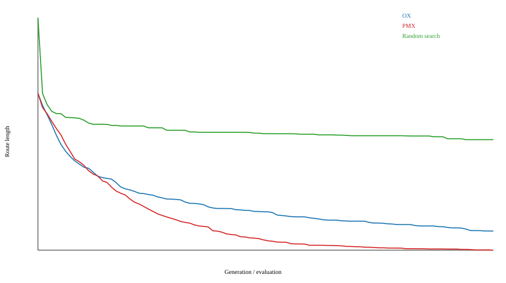
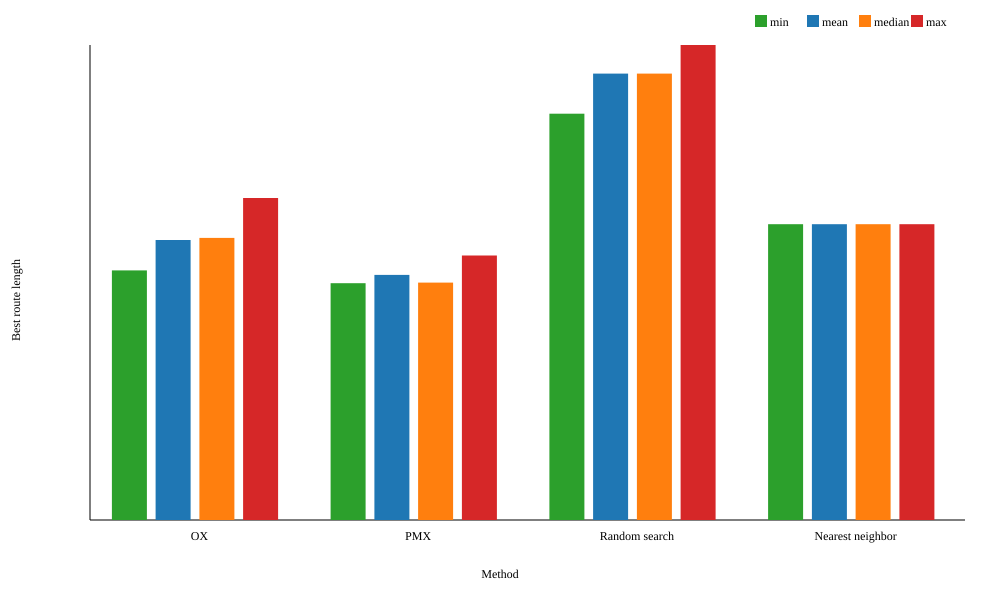
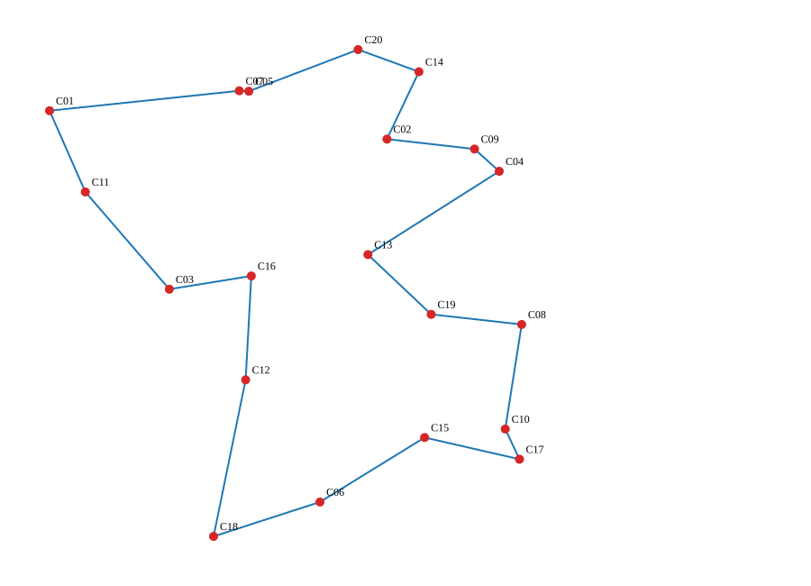
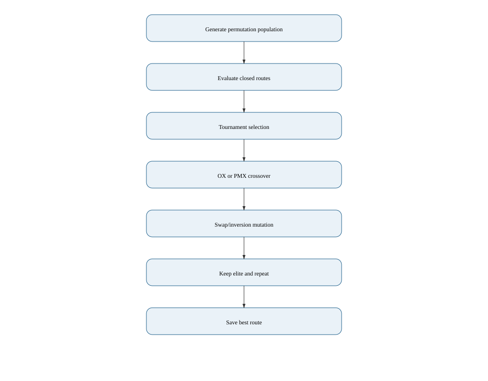

# Лабораторная работа №2

## Генетический алгоритм для задачи коммивояжёра

### 1. Индивидуальный вариант и постановка задачи

Исходные данные студента: `N=21`, группа `517`, `Q=1`, год `2026`,
`Y=26`. Номер варианта вычисляется по формуле из методички:

```text
V = 1 + ((17N + 7Q + Y) mod 20)
  = 1 + ((17*21 + 7*1 + 26) mod 20)
  = 1 + (390 mod 20) = 11.
```

Для варианта `V=11` требуется решить задачу коммивояжёра на 15--25
вершинах. В работе используется 20 городов. Для каждого города заданы
координаты на плоскости, расстояние между городами является евклидовым.
Необходимо построить замкнутый маршрут минимальной длины, проходящий через
каждый город ровно один раз:

```text
L(pi) = sum(d[pi_i, pi_(i+1)]),  pi_(n+1) = pi_1.
```

Города сгенерированы синтетически равномерно в квадрате `[0,100] x [0,100]`
с фиксированным `data_seed=20260226`. Полный набор координат сохранён в
`lab2_results/cities.csv`.

### 1.1. Математическая модель

Пусть `C = {1, ..., n}`, где `n=20` — множество городов. Для каждого города
`i` задаётся точка `p_i=(x_i,y_i)`, причём:

```text
x_i ~ U(0,100),    y_i ~ U(0,100),    i=1,...,n.
```

Расстояние между городами вычисляется по евклидовой метрике:

```text
d_ij = sqrt((x_i - x_j)^2 + (y_i - y_j)^2).
```

Маршрут является перестановкой `pi=(pi_1,...,pi_n)` множества `C`. Ограничения
допустимости:

```text
pi_k in C                    для k=1,...,n,
pi_i != pi_j                 для i != j,
{pi_1,...,pi_n} = C.
```

Целевая функция минимизации замкнутого маршрута:

```text
F(pi) = sum(k=1..n-1, d_(pi_k,pi_(k+1))) + d_(pi_n,pi_1)
      -> min.
```

В турнирном отборе размера `t=3` выбирается лучшая особь:

```text
parent = arg min {F(pi_j) : j in S},    |S|=3.
```

При размере популяции `P=60` и `G=99` поколениях число вычислений функции:

```text
E = P * (G + 1) = 60 * 100 = 6000.
```

### 2. Представление решения и генетический алгоритм

Генотипом является перестановка чисел `0..19`. Например, маршрут
`[0, 4, 7, 2, ...]` означает посещение городов `C01, C05, C08, C03, ...`,
после последнего города выполняется возврат в первый. Дополнительное
декодирование не требуется: перестановка непосредственно является
маршрутом.

Такое представление отражает структуру задачи: каждый ген соответствует
ровно одному городу, а уникальность генов автоматически исключает
повторное посещение. Допустимый маршрут содержит все 20 различных номеров
ровно по одному разу. Решения после операторов проверяются функцией
`is_valid_route`; при нарушении инварианта программа завершает работу с
явной ошибкой.

Параметры эксперимента:

| Параметр | Значение |
|---|---:|
| Число городов | 20 |
| Размер популяции | 60 |
| Поколений | 99 |
| Оценок целевой функции | 6000 |
| Селекция | турнир размера 3 |
| Элитизм | 1 лучшая перестановка |
| Кроссоверы | OX и PMX |
| Мутации | обмен и инверсия |
| Вероятность каждой мутации | 0.2 |
| Независимых запусков | 20 |

#### 2.1. Кроссовер OX

В Order Crossover выбирается случайный сегмент первого родителя. Он
копируется в потомка, а оставшиеся позиции заполняются генами второго
родителя в порядке обхода, начиная после правой границы сегмента. Второй
потомок строится симметрично. OX сохраняет относительный порядок городов и
всегда выдаёт перестановку.

Если выбран сегмент `[a:b]`, то:

```text
child[a:b] = parent_1[a:b],
child outside [a:b] = genes(parent_2) \ child[a:b].
```

Оставшиеся гены записываются циклически в порядке второго родителя.

#### 2.2. Кроссовер PMX

В Partially Mapped Crossover выбранный сегмент копируется от одного
родителя, а соответствия генов между сегментами используются для заполнения
оставшихся позиций. PMX сохраняет позиционную информацию и также гарантирует
уникальность генов. В реализации нет обычного одноточечного кроссовера,
который мог бы создавать повторения городов.

Для выбранного сегмента отображение PMX задаётся:

```text
M(parent_1[k]) = parent_2[k],    k in [a:b].
```

Если ген уже занят, по цепочке `M` выбирается следующий свободный ген.
В результате для каждого потомка выполняется:

```text
length(child) = n,    |set(child)| = n.
```

#### 2.3. Мутации

Используются два содержательно разных оператора:

* **обмен (swap)** меняет местами два города;
* **инверсия (inversion)** разворачивает случайный непрерывный сегмент.

Для swap с позициями `a` и `b`:

```text
child[a] = parent[b],    child[b] = parent[a].
```

Для inversion:

```text
child[a:b] = reverse(parent[a:b]).
```

Обе операции являются биекциями над позициями маршрута и не изменяют
множество городов.

Оба оператора работают только с позициями существующей перестановки,
поэтому не нарушают допустимость маршрута. Лучшая особь переносится без
изменений, что обеспечивает монотонность лучшего значения внутри запуска.

### 3. Примеры допустимых и недопустимых решений

Допустимые решения:

```text
[1, 2, 3, 4, 5, ..., 20]
[15, 19, 8, 4, 14, 9, 2, 20, 5, 7, 13, 16, 11, 1, 3, 12, 18, 6, 17, 10]
```

В обоих случаях каждый город встречается ровно один раз.

Недопустимые решения:

```text
[1, 2, 3, 3, 5, ..., 20]       # город 3 повторяется, один город пропущен
[1, 2, 3, ..., 19]              # длина маршрута равна 19
```

Инициализация создаёт перестановки через `random.sample`, а OX, PMX, swap и
inversion сохраняют перестановочную структуру. Поэтому все особи,
передаваемые в оценивание, допустимы.

### 4. Экспериментальный план и базовые методы

Для каждого из 20 seed (`20260201`--`20260220`) выполнены два генетических
запуска с одинаковым бюджетом: один с OX, второй с PMX. Дополнительно
выполнен случайный допустимый поиск: на каждом шаге генерируется случайная
перестановка, всего 6000 оценок. Это сопоставимый по бюджету базовый метод.

Также рассчитан маршрут конструктивной эвристикой ближайшего соседа:
начинаем с `C01` и каждый раз выбираем ближайший ещё не посещённый город.
Эвристика приведена как понятная предметная точка сравнения, хотя она не
является стохастической серией из 20 запусков.

Исходные строки всех запусков находятся в `lab2_results/results.csv`,
средние траектории — в `lab2_results/trajectory.csv`.

### 5. Результаты

| Метод | Минимум | Среднее | Медиана | Ст. отклонение | Максимум |
|---|---:|---:|---:|---:|---:|
| ГА, OX | 397.718237 | 446.097772 | 449.536562 | 29.900476 | 513.050528 |
| ГА, PMX | 377.282451 | 390.527958 | 378.334685 | 15.920821 | 421.392699 |
| Случайный поиск | 647.400361 | 711.267508 | 711.353424 | 27.737978 | 756.845803 |
| Ближайший сосед | 471.264691 | 471.264691 | 471.264691 | 0 | 471.264691 |

PMX показал лучший результат: средняя длина маршрута `390.527958`, что на
12.5% меньше средней длины OX и на 45.1% меньше средней длины случайного
поиска. Кроме того, у PMX меньше стандартное отклонение, поэтому он
стабильнее между независимыми запусками. Лучший маршрут всей серии имеет
длину `377.282451`.



На графике показано среднее лучшее значение по 20 запускам. Для ГА один шаг
соответствует поколению, для случайного поиска — равномерно отображённой
последовательности оценок. Элитизм объясняет неубывающую динамику лучшего
значения.





Лучший маршрут представлен на координатной плоскости с возвратом из
последнего города в первый. В отличие от абстрактного вектора чисел, такое
представление непосредственно интерпретируется пользователем предметной
области.



### 6. Воспроизводимость

Запуск из корня репозитория:

```text
python lab2_tsp.py --run-experiments
```

Результаты не требуют внешних библиотек и воспроизводятся стандартным
модулем `random` Python. Координаты городов, seed запусков и параметры
алгоритма сохранены в `lab2_config.json`.

### 7. Вывод

В работе реализован генетический алгоритм для дискретной задачи
коммивояжёра с корректным перестановочным кодированием. Специализированные
кроссоверы OX и PMX, а также swap/inversion не создают недопустимых
маршрутов. Выполнены 20 независимых запусков двух вариантов алгоритма и
сравнение со случайным поиском и ближайшим соседом.

По среднему качеству и устойчивости лучшим оказался PMX. Оба генетических
варианта заметно превосходят случайный допустимый поиск при одинаковом
бюджете 6000 оценок. В представленной серии PMX также лучше эвристики
ближайшего соседа, что подтверждает пользу рекомбинации удачных
перестановок для выбранных данных.

### 8. Проверка соответствия требованиям

| Требование методички | Реализация |
|---|---|
| Индивидуальный вариант | `V=11`, раздел 1 |
| Дискретное представление | перестановка из 20 городов |
| Специализированные операторы | OX, PMX, swap, inversion |
| Обработка допустимости | инвариант перестановки и проверка маршрутов |
| Два подхода/оператора | OX против PMX, две мутации |
| Не менее 20 запусков | 20 запусков каждого метода |
| Сопоставимый базовый метод | случайный поиск на 6000 оценок |
| Понятное лучшее решение | таблица маршрута и `best_route.svg` |
| Графики и статистика | convergence, statistics, best_route |
| Воспроизводимые входные данные | `cities.csv`, `data_seed=20260226` |
